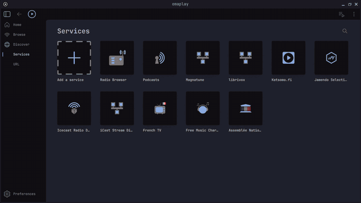
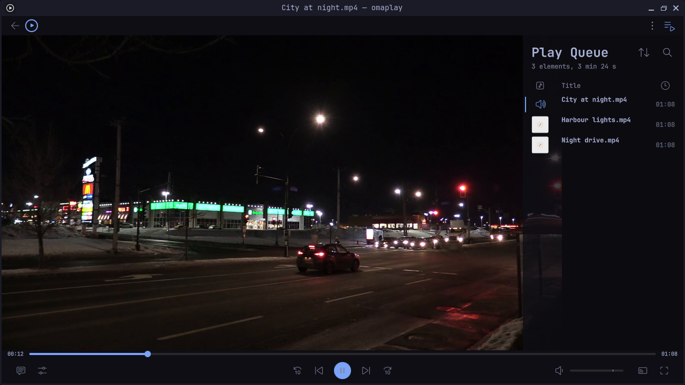
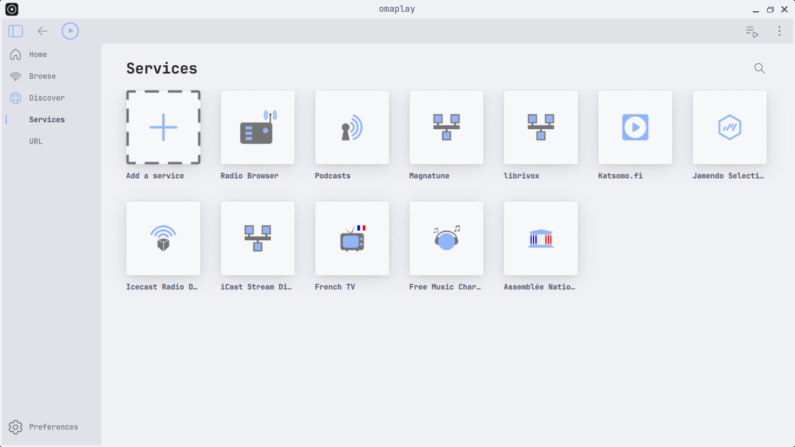
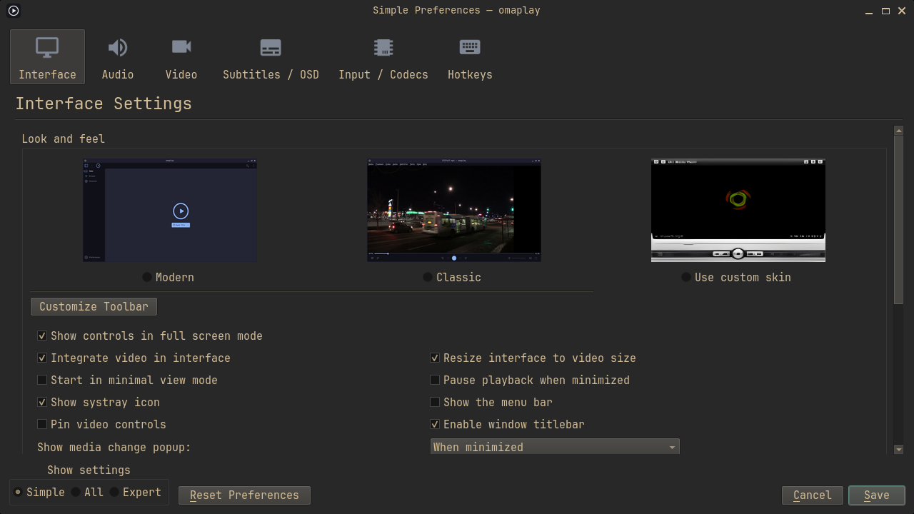
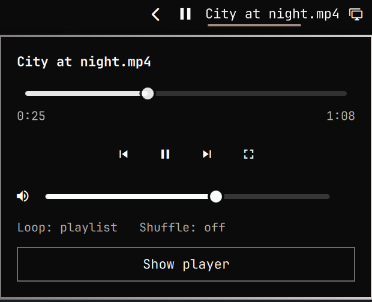

# omaplay

**VLC, dressed for Omarchy.** omaplay is VLC 4 with an interface that follows your Omarchy desktop: your theme, your font,
your corner radius, live. Switch themes with `omarchy theme set` and the player recolours mid-video. Every VLC feature,
codec and option is still there (except the media library; see Limitations).



> **Experimental.** omaplay is built on a development snapshot of VLC 4, which VideoLAN has not released yet.
> It installs *beside* the official `vlc` package and never touches it, so you can always go back. Updates to newer VLC
> snapshots are made on demand; open an issue if you need one.

## What's different from stock VLC

- **Follows your Omarchy theme, live.** Colours come from the active theme, including light themes, with readable contrast
  enforced. Preferences, effects and the other classic dialogs are themed too.
- **Omarchy feel.** Your Omarchy font, Hyprland's corner radius, no client-side title bar, short ease-out motion that
  switches off with `omarchy toggle animations`.
- **Command palette.** `Ctrl+K` searches every dialog and every one of VLC's 100+ actions, showing your current shortcuts.
  `?` (Shift+/) lists all bound shortcuts.
- **Keyboard queue.** `Alt+Up` / `Alt+Down` move items in the play queue.
- **Recent files** on the home screen, without needing the media library.
- **Controls hide after 3 s** of no activity, so the video gets the screen.
- **Software decoding by default.** Some Intel drivers show a black picture with VLC's hardware decoding. Set Preferences > Input / Codecs >
  Hardware-accelerated decoding to Automatic if it works on your machine.
- **Bar widget.** The companion [omaplay plugin](https://github.com/T3-Venture-Labs-Limited/omaplay-plugin) puts what's playing
  in the Omarchy bar with a mini player and keybinding targets.

| | |
|---|---|
|  |  |
|  |  |



## Install

omaplay needs Omarchy 4 (or another Arch-based setup with Hyprland; theme following needs Omarchy).

**From the AUR** (once published):

```bash
omarchy pkg aur add omaplay
```

**From source:**

```bash
git clone https://github.com/T3-Venture-Labs-Limited/omaplay.git
cd omaplay
bin/install            # builds the package with makepkg (about 5 minutes) and installs it with pacman
```

Then open **omaplay** from the app launcher, or run `omaplay video.mp4`. It is not made your default player; choose it from
your file manager's "Open with" if you want that.

Add the bar widget:

```bash
omarchy plugin add https://github.com/T3-Venture-Labs-Limited/omaplay-plugin.git --enable
```

## Remove

```bash
sudo pacman -R omaplay
rm -rf ~/.config/omaplay ~/.local/share/omaplay ~/.cache/omaplay   # optional: settings, history, cache
```

The official VLC, if installed, keeps working and keeps its own settings.

## How it works

omaplay is the upstream VLC source at one pinned commit (`UPSTREAM`) plus a series of patches (`patches/`). It is not a
new player: decoding, streaming and every module are VLC's. The patches add an Omarchy colour scheme that reads the active
theme and watches it for changes, restyle the Qt Quick interface, add the command palette, and give the build its own
name, settings directory (`~/.config/omaplay`), MPRIS name and install prefix (`/opt/omaplay`), so it can live beside VLC.
VLC's decoding and playback code is unchanged; outside the interface the patches only change names, paths and defaults.

Every stock VLC option and hotkey is checked to still exist (`bin/parity`, results in `docs/PARITY.md`).
What has and has not been tested is listed in `docs/ACCEPTANCE.md`.

## Limitations

- **No media library** (Music and Video collection views). VLC 4's media library depends on a library version that is not
  available yet; Browse, Discover, the play queue and recent files work.
- Tested on one machine (Intel + NVIDIA, Omarchy 4.5, Hyprland). Reports from other hardware are welcome.
- VLC 4 is pre-release; expect the occasional upstream rough edge.

## Development

See [docs/DEVELOPMENT.md](docs/DEVELOPMENT.md) to build and test, and [docs/MAINTAINING.md](docs/MAINTAINING.md) to move to a
newer VLC.

## License and trademarks

omaplay is free software under the GNU General Public License, version 2 or later, like VLC. See `LICENSE`.
The source for every binary is this repository plus the upstream VLC commit in `UPSTREAM`.

omaplay is an independent project. It is **not affiliated with or endorsed by VideoLAN**. VLC, VideoLAN and the VLC cone are
trademarks of VideoLAN; omaplay uses its own name and artwork and credits VLC in its About dialog.

The demo footage is a stock clip from Pexels.
