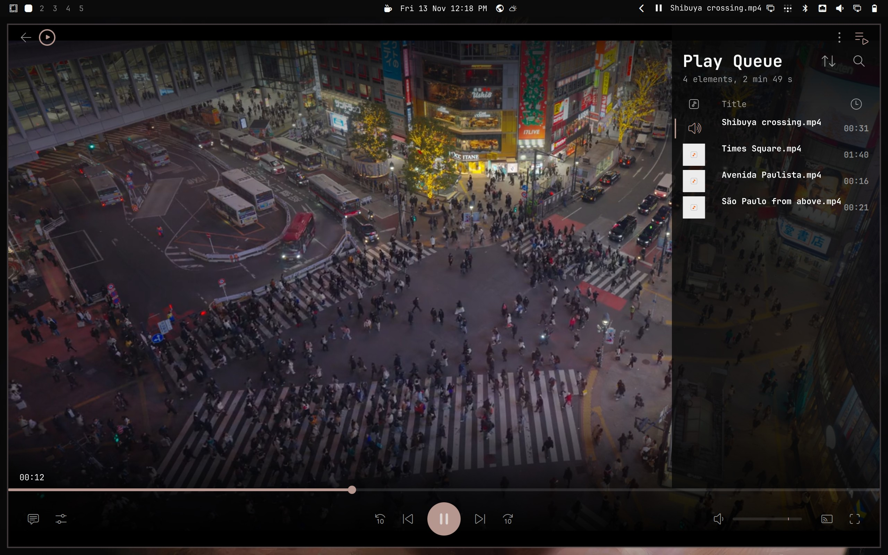
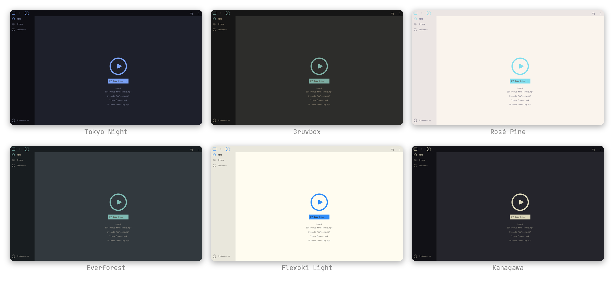
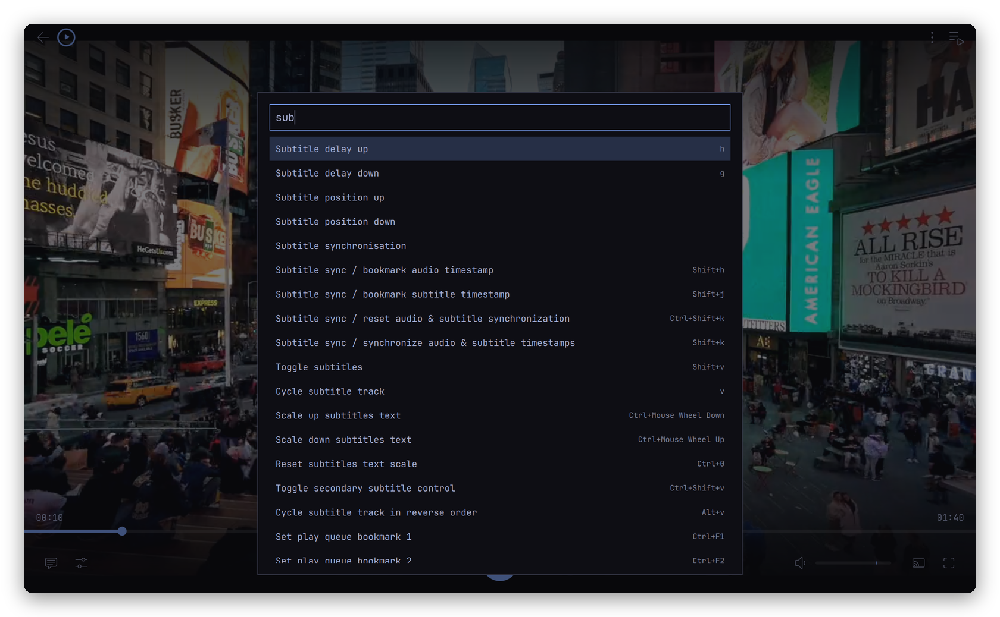
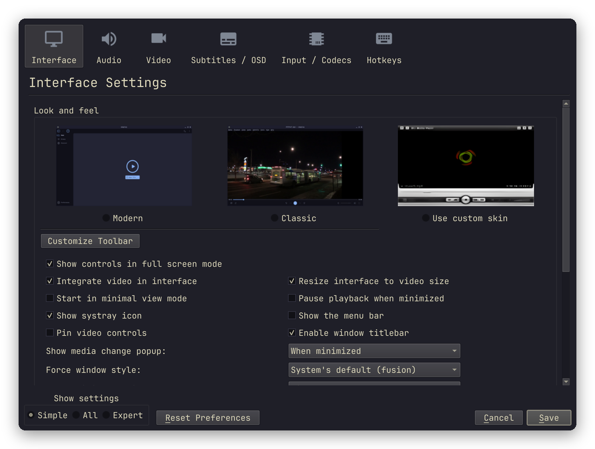
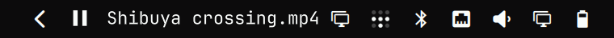

# omaplay

**VLC, dressed for Omarchy.** A media player that follows your Omarchy desktop (theme, font and corner radius) and
recolours live when you switch themes. Underneath it is VLC 4, so every codec, format, stream and option is still there.

[](https://github.com/T3-Venture-Labs-Limited/omaplay/actions/workflows/ci.yml)
[](LICENSE)

-orange)




> **Experimental.** omaplay is built on a development snapshot of VLC 4, which VideoLAN has not released yet.
> It installs *beside* the official `vlc` package and never touches it, so you can always go back.

## Highlights

- **Follows your Omarchy theme, live.** Colours come from the active theme, light themes included, with readable contrast
  enforced. Preferences and the other classic dialogs are themed too.
- **Feels like the rest of Omarchy.** Your Omarchy font, Hyprland's corner radius, no client-side title bar, and short
  ease-out motion that switches off with `omarchy toggle animations`.
- **Command palette.** `Ctrl+K` searches every dialog and all of VLC's 100+ actions, showing your current shortcuts.
- **Keyboard first.** `?` lists every bound shortcut, and `Alt+Up` / `Alt+Down` reorder the play queue.
- **Recent files** on the home screen, without needing the media library.
- **The video gets the screen.** Controls hide after 3 seconds without activity.
- **Bar widget.** The companion [omaplay plugin](https://github.com/T3-Venture-Labs-Limited/omaplay-plugin) shows what's
  playing in the Omarchy bar, with a mini player and keybinding targets.
- **Still all of VLC.** Every stock option and hotkey is checked to still exist ([docs/PARITY.md](docs/PARITY.md)).

## Screenshots

**Every Omarchy theme, light or dark.** The same home screen under six of Omarchy's themes:



**Live theme switching.** `omarchy theme set` recolours the player mid-video:


**Command palette.** `Ctrl+K`, type a few letters, Enter:



**VLC's full preferences,** themed to match (Kanagawa here):



**In your bar.** The [plugin](https://github.com/T3-Venture-Labs-Limited/omaplay-plugin) shows what's playing; click it
for the mini player:




## Install

omaplay needs Omarchy 4 (or another Arch-based setup with Hyprland; following the theme needs Omarchy).

**From the AUR** (once published):

```bash
omarchy pkg aur add omaplay
```

**From source:**

```bash
git clone https://github.com/T3-Venture-Labs-Limited/omaplay.git
cd omaplay
bin/install            # builds the package with makepkg (about 5 minutes) and installs it with pacman
```

Then open **omaplay** from the app launcher, or run `omaplay video.mp4`. It is not made your default player; choose it from
your file manager's "Open with" if you want that.

Add the bar widget:

```bash
omarchy plugin add https://github.com/T3-Venture-Labs-Limited/omaplay-plugin.git --enable
```

## Keyboard

All of VLC's hotkeys work as before (Preferences > Hotkeys). omaplay adds:

| Key | Does |
|---|---|
| `Ctrl+K` | command palette: search every action and dialog |
| `?` (`Shift+/`) | list every bound shortcut |
| `Alt+Up` / `Alt+Down` | move the selected play-queue item |
| `Ctrl+L` | show or hide the play queue |
| `Ctrl+P` | preferences |

## Remove

```bash
sudo pacman -R omaplay
rm -rf ~/.config/omaplay ~/.local/share/omaplay ~/.cache/omaplay   # optional: settings, history, cache
```

The official VLC, if installed, keeps working and keeps its own settings.

## How it works

omaplay is the upstream VLC source at one pinned commit ([`UPSTREAM`](UPSTREAM)) plus a series of patches
([`patches/`](patches)). It is not a new player: decoding, streaming and every module are VLC's. The patches:

- add an Omarchy colour scheme that reads the active theme and watches it for changes;
- restyle the Qt Quick interface and add the command palette;
- give the build its own name, settings directory (`~/.config/omaplay`), MPRIS name and install prefix (`/opt/omaplay`),
  so it can live beside VLC.

VLC's decoding and playback code is unchanged. Outside the interface, the patches only change names, paths and defaults.
What has and has not been tested is listed in [docs/ACCEPTANCE.md](docs/ACCEPTANCE.md).

## Limitations

- **No media library** (the Music and Video collection views). VLC 4's media library depends on a library version that is
  not packaged yet. Browse, Discover, the play queue and recent files work.
- **Software decoding by default.** Some Intel drivers show a black picture with VLC's hardware decoding. If it works on
  your machine, set Preferences > Input / Codecs > Hardware-accelerated decoding to Automatic.
- Tested on one machine (Intel + NVIDIA, Omarchy 4.5, Hyprland). Reports from other hardware are welcome.
- VLC 4 is pre-release; expect the occasional upstream rough edge. Updates to newer VLC snapshots are made on demand; open
  an issue if you need one.

## Contributing

Bug reports and pull requests are welcome; see [CONTRIBUTING.md](CONTRIBUTING.md). To build and test, see
[docs/DEVELOPMENT.md](docs/DEVELOPMENT.md); to move to a newer VLC, see [docs/MAINTAINING.md](docs/MAINTAINING.md).
Security issues: [SECURITY.md](SECURITY.md).

## License, trademarks and credits

omaplay is free software under the GNU General Public License, version 2 or later, like VLC. See [`LICENSE`](LICENSE).
The source for every binary is this repository plus the upstream VLC commit in [`UPSTREAM`](UPSTREAM).

omaplay is an independent project. It is **not affiliated with or endorsed by VideoLAN**. VLC, VideoLAN and the VLC cone are
trademarks of VideoLAN; omaplay uses its own name and artwork and credits VLC in its About dialog.

The footage in the screenshots is from [Pexels](https://www.pexels.com): Shibuya crossing by Timo Volz, Times Square by
Sarowar Hussain, Avenida Paulista by Carlos Diego Magalhães, São Paulo from above by Aaron Hairston.
